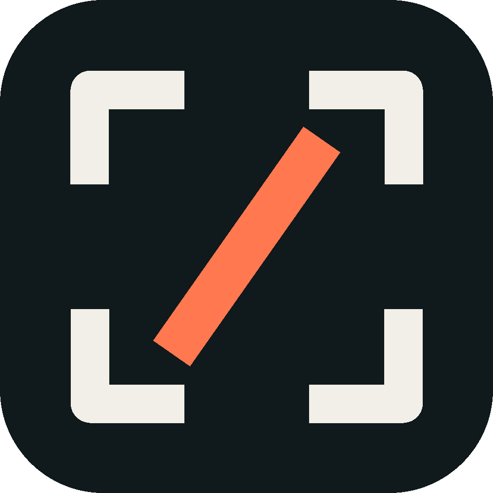
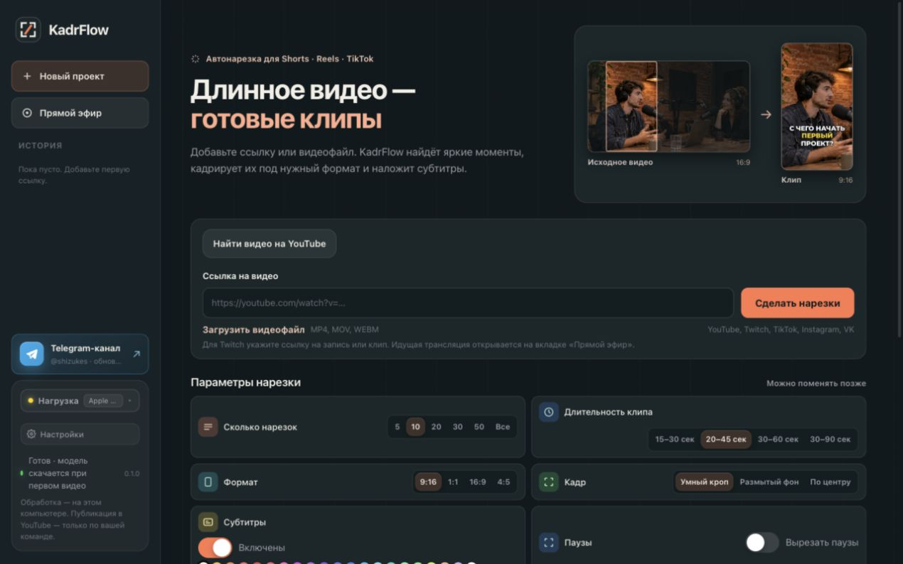
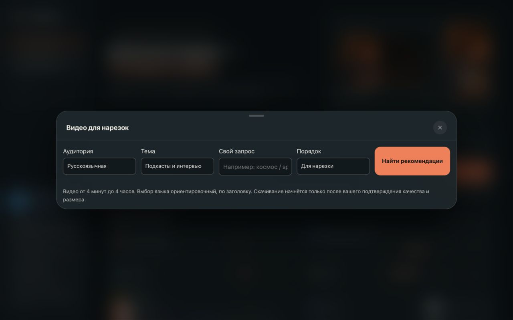
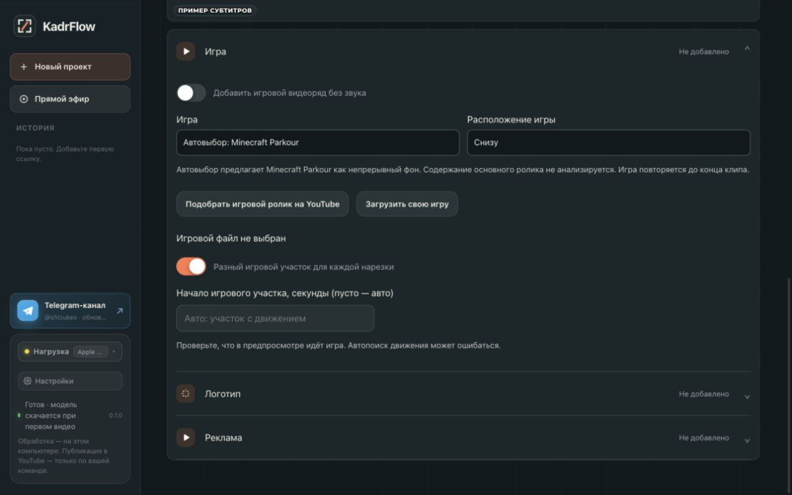
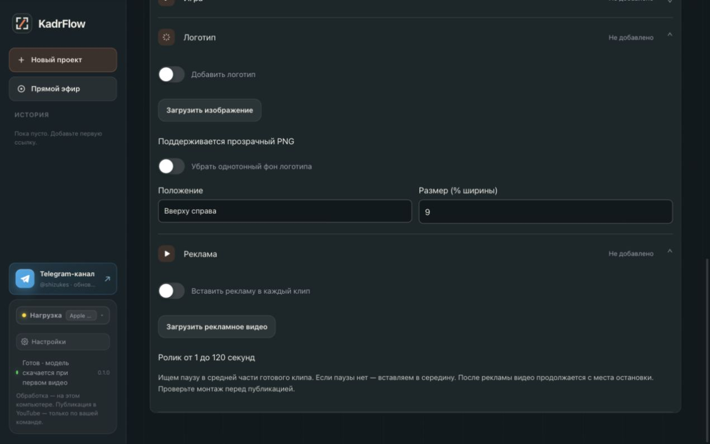
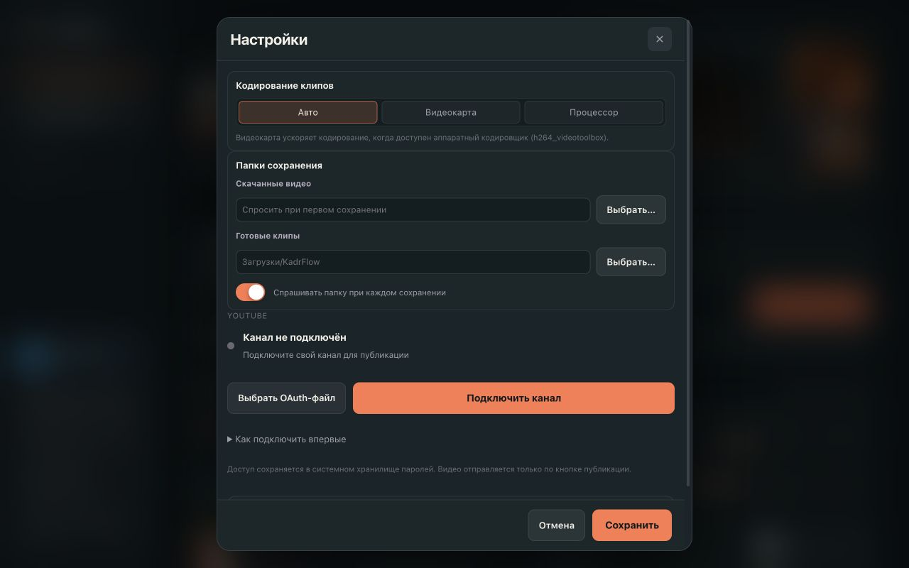
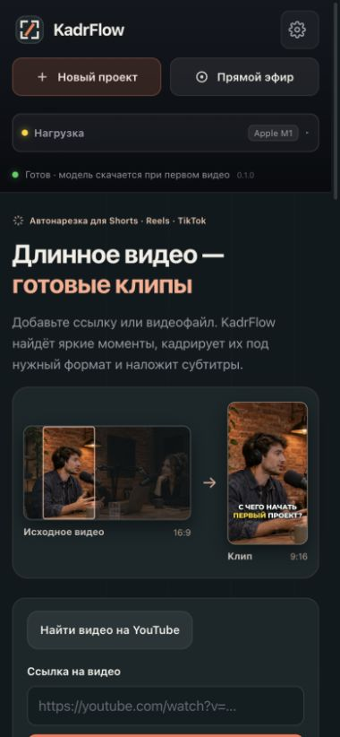

<p align="center">
  
</p>

<h1 align="center">KadrFlow</h1>

<p align="center">
  <b>Найти видео → нарезать → оформить → опубликовать.</b><br/>
  Локальное приложение для коротких роликов: рекомендации YouTube, игровой видеоряд,
  логотип, рекламные вставки и публикация на YouTube.
</p>

<p align="center">
  
  
  <a href="https://t.me/shizukes"></a>
</p>

<p align="center">
  <a href="https://github.com/Mr-X-01/kadrflow/archive/refs/heads/main.zip"><b>Скачать исходники</b></a>
  &nbsp;·&nbsp; <a href="#быстрый-запуск">Запуск</a>
  &nbsp;·&nbsp; <a href="#интерфейс">Скриншоты</a>
  &nbsp;·&nbsp; <a href="#подключение-youtube">YouTube</a>
</p>

KadrFlow — самостоятельный проект [Mr-X-01](https://github.com/Mr-X-01).
В этом репозитории находятся исходники. Упакованные приложения появятся
в [Releases](https://github.com/Mr-X-01/kadrflow/releases), когда будут собраны и проверены.

## Возможности

### Источник и поиск

| Возможность | Как работает |
|---|---|
| Ссылка или файл | Поддерживаются YouTube, Twitch, Kick, TikTok, Instagram, VK, X, прямые MP4/HLS и локальные видеофайлы. Доступность отдельных ссылок зависит от источника и yt-dlp. |
| Поиск YouTube | Подборки для русскоязычной и англоязычной аудитории, выбор темы, свой запрос и сортировка по просмотрам или пригодности для нарезки. Перед скачиванием можно проверить качество и размер. |
| Прямой эфир | Запись трансляции и создание клипов во время эфира; готовые клипы можно пересобрать из сохранённого материала. |
| Доступ к источнику | Если площадка требует вход, можно выбрать cookies из установленного браузера. Это влияет на скачивание источника, а не на публикацию. |

Язык рекомендации определяется по заголовку, а просмотры берутся из общедоступного
счётчика. Это ориентир для выбора исходника, а не измерение аудитории видео.

### Нарезка и оформление

| Настройка | Что доступно |
|---|---|
| Короткие клипы | 5, 10, 20, 30, 50 или все найденные моменты; диапазоны длительности от 15 до 90 секунд. Рейтинг момента помогает сортировать кандидатов, но не предсказывает будущие просмотры. |
| Формат и кадр | 9:16, 1:1, 16:9 и 4:5; умный кроп по лицу, размытый фон или кадр по центру. |
| Субтитры | Распознавание Whisper, подсветка слов, выбор языка, цвета, шрифта, размера, положения и темпа. Можно загрузить свой шрифт. |
| Паузы | По желанию вырезаются участки тишины; тайминги встроенных субтитров пересчитываются для итогового видео. |
| Игра рядом с видео | Игровой ряд сверху или снизу без звука: свой файл или выбранная после подтверждения запись YouTube. Игра занимает 40% высоты, основной ролик — 60%. Для разных клипов выбираются разные участки, можно указать старт вручную. |
| Логотип | PNG, JPEG или WebP; четыре угла, размер 5–30% ширины, прозрачность PNG или удаление однотонного фона. |
| Реклама | Свой видеоролик вставляется в паузу ближе к середине клипа; при отсутствии паузы — в середину. Основное видео затем продолжается с места остановки. |
| Редактор и экспорт | Просмотр и пересборка клипов, сохранение MP4, отдельного SRT и архива ZIP. |

Игра, логотип и реклама настраиваются **в тех же «Параметрах нарезки»**,
что формат и субтитры. Для готового проекта настройки можно изменить и
пересобрать результат.

### Публикация и обновления

- **YouTube:** подключение своего канала через Google OAuth, предпросмотр,
  заголовок и описание, выбор доступа и аудитории, фоновая очередь, отмена и
  запланированное открытие доступа. По умолчанию видео загружается как личное.
- **Обновления:** приложение проверяет [Releases KadrFlow](https://github.com/Mr-X-01/kadrflow/releases)
  и показывает доступную версию. Проверку можно отключить в настройках или через
  `KADRFLOW_UPDATE_CHECK=0`. Установка обновления автоматически не выполняется.

## Интерфейс

Все снимки ниже сделаны в KadrFlow 0.1.0 без добавленных пользовательских видео.

### Главный экран

Поиск, загрузка файла и основные параметры нарезки находятся на одной странице.



### Поиск рекомендаций YouTube

Можно выбрать аудиторию, тему, собственный запрос и порядок выдачи.



### Игра, логотип и реклама

Для игры можно выбрать ролик, расположение и участок для каждой нарезки.
Логотип и рекламный ролик добавляются рядом с настройками игры.




### Настройки приложения

Папки, кодирование, журнал и подключение YouTube собраны в одном окне.



### Мобильный вид

<p align="center">
  
</p>

## Как это работает

1. Вставьте ссылку, загрузите свой файл или найдите видео через **«Найти видео на YouTube»**.
2. Для найденного видео выберите качество и подтвердите скачивание; для своего файла этот шаг не нужен.
3. Настройте формат, длительность, субтитры, игровой ряд, логотип и рекламу.
4. Приложение распознает речь через Whisper, выберет моменты и соберёт клипы через FFmpeg.
5. Просмотрите результат, скачайте MP4/ZIP или нажмите **«На YouTube»** у готового клипа.

Распознавание речи, отбор моментов и монтаж выполняются на компьютере.
Поиск и скачивание обращаются к источнику видео; публикация отправляет выбранный
MP4 в YouTube только после нажатия кнопки загрузки.

## Использование с телефона

Интерфейс адаптирован под узкие экраны: компактная навигация, формы в одну
колонку, увеличенные области нажатия и окна с учётом высоты мобильного экрана.
Настройки игры, логотипа, рекламы и публикации используют общие мобильные стили.
Панель нагрузки по умолчанию свёрнута на телефоне и располагается под диалогами.

Главная страница визуально проверена в режиме адаптивного дизайна Safari на
ширине **320 и 390 px**. Синтаксис JavaScript проверен; полная проверка всех
сценариев на физических устройствах пока не проводилась.

При размещении приложения на сервере мобильная вёрстка сохраняется. Текущая
авторизация YouTube рассчитана на локальный запуск через Desktop OAuth:
подключение канала из браузера телефона к удалённому серверу требует отдельной
адаптации OAuth. Мобильная вёрстка сама по себе не превращает приложение в
готовый многопользовательский сервис.

## Быстрый запуск

### macOS / Linux — в браузере

Нужен Python 3.12 или новее.

```bash
git clone https://github.com/Mr-X-01/kadrflow.git
cd kadrflow
./run.sh
```

Откройте [http://127.0.0.1:8765](http://127.0.0.1:8765).
Первый запуск создаёт виртуальное окружение и устанавливает зависимости.
FFmpeg поставляется через `imageio-ffmpeg`; при отсутствии локальной модели
Whisper приложение попробует скачать её при распознавании.

### Windows 10/11 — локальный сайт в браузере

Установите **Python 3.12 x64**, скачайте исходники и распакуйте архив.
Откройте PowerShell в папке проекта и выполните:

```powershell
py -3.12 run_web.py
```

При первом запуске создаётся `.venv-web` и устанавливаются зависимости из
`requirements.txt`. Затем откроется браузер с **http://127.0.0.1:8765/**.
BAT-файл, сборка EXE приложения и WebView2 для этого режима не нужны.
Python и локальный сервер необходимы для обработки видео.

Оставьте терминал открытым, пока пользуетесь сайтом. Для остановки нажмите
**Ctrl+C**. Чтобы запустить снова, выполните ту же команду. Если порт занят:

```powershell
py -3.12 run_web.py --port 8770
```

Сервер по умолчанию доступен только на этом компьютере. Проекты, клипы и модели
хранятся в папке `data` проекта (или в пути из `KADRFLOW_DATA`). При первом
распознавании может потребоваться скачивание модели Whisper.

Для подготовленного Python-окружения: `python -m kadrflow --open-browser`.
Подробнее: [Windows](docs/WINDOWS.md).

### Сборка настольного приложения

- macOS: `./build_app.sh` → `dist/KadrFlow.app`.
- Windows: `powershell -ExecutionPolicy Bypass -File build_windows.ps1`.

Модель Whisper, видео проектов, готовые клипы и локальное окружение не входят
в архив исходников репозитория.

## Подключение YouTube

1. В Google Cloud создайте проект и включите **YouTube Data API v3**.
2. Настройте OAuth consent screen; в режиме Testing добавьте свой аккаунт в Test users.
3. Создайте OAuth client ID типа **Desktop app** и скачайте JSON.
4. В KadrFlow откройте **Настройки → YouTube → Выбрать OAuth-файл**.
5. Нажмите **«Подключить канал»** и подтвердите доступ в окне Google.

После подключения у готового клипа доступна отправка с предпросмотром, названием,
описанием, выбором аудитории и доступа. По умолчанию видео загружается как **личное**.
Для расписания загрузка выполняется сейчас, а открытый доступ включает YouTube
в выбранное время. YouTube самостоятельно определяет, относится ли видео к Shorts.

Токены хранятся через `keyring` в системном хранилище паролей. Вход использует
OAuth со state и PKCE. Есть фоновая очередь, прогресс, отмена и защита от повторной
отправки неизменённого файла. Реальная отправка в пользовательский канал пока
не проверялась: тесты OAuth и загрузки выполнялись без отправки видео в Google.

[Подробности функций и ограничений →](docs/FEATURES.md)

## Что важно учитывать

- **Рекомендации:** язык предполагается по заголовку. Просмотры общие; состав
  русской/английской аудитории не измеряется. Это подборка результатов поиска,
  а не полный рейтинг YouTube и не прогноз просмотров.
- **Игра:** поиск движения может ошибиться. Есть предпросмотр и ручное начало.
  На коротком исходнике участки могут пересекаться и повторяться.
- **Реклама:** выбирается подходящая пауза возле середины; если её нет — середина
  клипа. Смысловая граница фразы нейросетью не определяется.
- **Субтитры:** встроенные в видео субтитры останавливаются на рекламе вместе
  с основным роликом. Отдельный SRT остаётся на шкале исходного фрагмента.
- **Материалы:** используйте видео и игровые записи с разрешением на обработку
  и публикацию.

## Проверки

На macOS Apple Silicon / Python 3.13 выполнены **146 тестов**: ошибок нет,
8 тестов пропущены. Проверены синтаксис JavaScript и сценариев shell,
компиляция Python. Локальный сервер и интерфейс открывались на ширине
1280 и 390 px; проверены поиск, блоки игры/логотипа/рекламы, настройки и ошибки консоли.

```bash
python -m unittest discover -s tests -p 'test_*.py'
node --check web/app.js
```

Запуск на реальном Windows, публикация в настоящий канал YouTube и сборки
настольных приложений для версии 0.1.0 пока не проверены.

## Происхождение и компоненты

Сведения о происхождении исходного кода — в [NOTICE.md](NOTICE.md).
Лицензии сторонних компонентов — в [THIRD_PARTY_NOTICES.md](THIRD_PARTY_NOTICES.md).
Отдельная лицензия на исходный код KadrFlow пока не опубликована.
